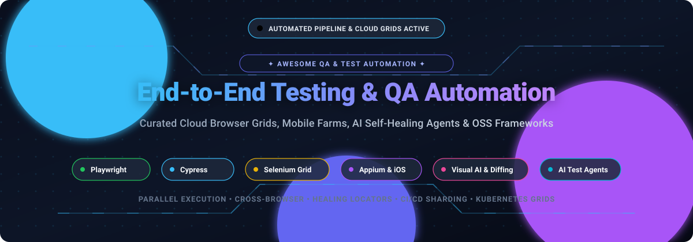

# Awesome-End-To-End-Testing-QA-Automation-Frameworks


  





  
  
  
  
  



# 🧪 Top End-to-End Testing & QA Automation Frameworks

**Curated List of SaaS Products & Open-Source GitHub Projects**  
*Focused on Browser & Mobile E2E Automation, Parallel Cloud Grids, Visual Regression Testing, Self-Healing AI Test Agents & Open-Source Selenium/Playwright Grids*  
**Last updated: November 2026**

This repository tracks notable **SaaS platforms** and **open-source projects** for **End-to-End (E2E) Testing & QA Automation Frameworks**. These tools power cross-browser and mobile end-to-end test execution, self-hosted Kubernetes browser grids, AI-assisted visual regression testing, no-code/low-code test recording, synthetic API/UI monitoring, and CI/CD test sharding for QA engineers, SDETs, and full-stack developers.

**Examples** include BrowserStack, Sauce Labs, Playwright Cloud (Microsoft Azure Playwright Workspaces), Testim (Tricentis), LambdaTest, Applitools, Cypress Cloud, mabl, Rainforest QA, and Selenium Grid (Hosted/Cloud Providers) (the category leaders).

**🚀 Open-source emphasis**: This section is heavily expanded with every major active project for E2E browser/mobile automation frameworks (`Playwright`, `Cypress`, `Selenium`, `WebdriverIO`, `Puppeteer`, `Appium`, `Maestro`), self-hosted cloud grid orchestration (`Selenium Grid`, `Moon`, `Selenoid`, `Currents / Sorry-Cypress`), visual diffing (`BackstopJS`, `Lost Pixel`, `Reg-Suit`), and AI-driven E2E agents (`tester-army/e2e`, `Midscene.js`, `Skyvern`) — ideal for engineering teams seeking zero per-minute cloud testing lock-in.

🤝 Contributions welcome! Open a PR to add/update entries. Keep descriptions factual and link to official sites.

## 📑 Table of Contents
- [📊 Sector Overview & Market Dynamics](#-sector-overview--market-dynamics)
- [☁️ SaaS/Hosted Platforms](#️-saashosted-platforms)
- [💻 Open-Source GitHub Projects](#-open-source-github-projects)
- [🛠️ How to Contribute](#️-how-to-contribute)
- [⚠️ Disclaimer](#️-disclaimer)
- [💖 Support & Thank You](#-support--thank-you)

## 📊 Sector Overview & Market Dynamics

The global Software Testing & QA Automation market is valued at approximately **$55B–$62B+ in 2026** (with specialized automated E2E testing tools & cloud device grids accounting for **$12B–$16B**), expanding at a ~14%–18% CAGR driven by AI self-healing locators and autonomous QA agents. The commercial device-cloud layer exhibits **strong winner-take-most consolidation** around BrowserStack, Sauce Labs, and LambdaTest, whereas the underlying test-authoring framework layer is **overwhelmingly open-source and moderately consolidated** around Playwright, Cypress, Selenium, and Appium.

## ☁️ SaaS/Hosted Platforms

*Sorted descending by company valuation / annual revenue scale.*

| Platform | Description | Company Scale (Valuation / Revenue) | Starting Paid Tier | Free Tier / Trial Limit |
| :--- | :--- | :--- | :--- | :--- |
| **[BrowserStack](https://browserstack.com)** | Cloud web and mobile testing platform offering instant access to 20,000+ real iOS/Android devices and desktop browsers for Playwright, Cypress, and Selenium. | **$4.0B Valuation** (~$300M+ est. ARR) | **$29/mo** billed annually ($39/mo monthly for Live Desktop) or **$129/mo** Automate | **Forever Free Open-Source / Limited Live Tier** (Unlimited free minutes for verified open-source projects; 1-minute interactive session preview / 100 automate mins trial) |
| **[Microsoft Playwright Workspaces (Playwright Cloud)](https://microsoft.com)** | Fully managed Azure cloud service running massively parallel Playwright end-to-end test suites across Linux and Windows browsers with trace reporting. | **Part of Microsoft Azure** (~$85B+ Azure cloud revenue; ~$3T+ parent market cap) | **$0.01 / test minute** (Linux) or **$0.02 / test minute** (Windows) pay-as-you-go | **100 Free Test Minutes** (30-day free trial with 100 browser test minutes on Azure before pay-as-you-go billing begins) |
| **[Sauce Labs](https://saucelabs.com)** | Enterprise continuous testing cloud providing real mobile device farms, virtual emulators, Selenium/Playwright grids, and error reporting. | **~$1.0B+ Est. Valuation** (~$150M+ est. ARR; backed by Riverwood Capital) | **$39/mo** billed annually ($49/mo monthly for Live Testing) or **$149/mo** Virtual Cloud | **28-Day Free Trial** (Includes 60 minutes of automated testing and 60 minutes of live cross-browser/mobile testing; free tier for OSS projects) |
| **[Testim (Tricentis)](https://testim.io)** | AI-powered end-to-end test automation platform featuring smart self-healing locators, visual test authoring, and Salesforce/mobile support. | **Part of Tricentis** (~$4.5B Tricentis valuation; ~$400M+ parent ARR) | **~$450/mo** indicative starting Essentials/Pro tier (custom enterprise volume quotes) | **Forever Free Community Plan** (Up to **1,000 test runs/month** on local Chrome/Chromium via CLI with visual editor; 14-day Pro cloud trial) |
| **[LambdaTest](https://lambdatest.com)** | AI-native test orchestration and execution cloud supporting HyperExecute parallel runners, real devices, and visual regression across 3,000+ environments. | **~$500M–$700M Est. Valuation** (~$50M–$80M est. ARR; $100M+ VC funding) | **$15/mo** billed annually ($19/mo monthly for Live) or **$99/mo** Web & Mobile Automation | **Forever Free Lifetime Plan** (60 minutes/month of real-time browser testing, 100 automation minutes for 15 days, and SmartUI screenshot quotas) |
| **[Applitools](https://applitools.com)** | Visual AI testing and monitoring platform (Eyes) detecting layout, rendering, and accessibility regressions across web, mobile, and PDFs. | **~$300M–$500M Est. Valuation** (Acquired by Thoma Bravo; ~$50M+ est. ARR) | **~$99–$199/mo** indicative starting Starter tier (custom enterprise pricing by checkpoints) | **Forever Free Tier** (1 user, up to **100 visual checkpoints/month**, and baseline history across SDKs; 14-day full Ultrafast Grid trial) |
| **[Cypress Cloud](https://cypress.io)** | Official commercial test orchestration, parallelization, flaky-test detection, and replay debugging dashboard for the open-source Cypress runner. | **~$100M–$150M Est. Valuation** (~$20M–$30M est. ARR; $55M+ VC funding) | **$67/mo** billed annually ($75/mo monthly for Team plan, includes 120,000 test results/yr) | **Forever Free Starter Plan** (Up to **3 users and 500 test results/month** with basic parallelization and replay artifacts) |
| **[mabl](https://mabl.com)** | Low-code, AI-native intelligent test automation SaaS unifying browser E2E, mobile, API, performance, and accessibility testing in one pipeline. | **~$100M–$150M Est. Valuation** (~$15M–$25M est. ARR; $76M+ VC funding) | **~$499/mo** indicative starting Startup/Growth subscription (custom quotes) | **14-Day Full-Access Free Trial** (Includes cloud test runs, auto-healing AI flows, and API/UI unified execution during evaluation) |
| **[Rainforest QA](https://rainforestqa.com)** | No-code automated E2E testing platform combining pixel-based visual assertions, AI test generation, and on-demand human crowd-tester fallback. | **~$50M–$80M Est. Valuation** (~$10M–$15M est. ARR; $40M+ VC funding) | **Usage-Based Starting ~$500/mo** (Billed by automated VM test runtime minutes + optional human tester credits) | **14-Day Free Trial / Guided Sandbox** (Limited automated test execution credits to build and run initial no-code browser flows) |
| **[Selenium Grid (Hosted Cloud Providers)](https://selenium.dev)** | Managed cloud deployments of the W3C WebDriver Selenium Grid protocol offered via AWS Device Farm, TestingBot, and Browserless. | **W3C Standard / Multi-Vendor Ecosystem** (AWS Device Farm starts at $0.17/device-min) | **$0.17 / device minute** (AWS Device Farm) or **~$25/mo** (TestingBot / Browserless entry) | **1,000 Free Device Minutes** (One-time free trial allocation on AWS Device Farm; 100 free automated minutes on TestingBot) |

## 💻 Open-Source GitHub Projects

| Project | License / Hosting Cost | Free Tier / Self-Hosted Limit | Description |
| :--- | :--- | :--- | :--- |
| **[Tester Army E2E (`tester-army/e2e`)](https://github.com)** | **Open-Source** ($0 self-hosted; bring-your-own LLM API keys or local models) | **100% Free forever** (Unlimited autonomous E2E test generation, execution, and self-hosted browser runs locally) | Open-source end-to-end testing and QA automation framework designed to streamline automated user-journey verification and regression workflows. |
